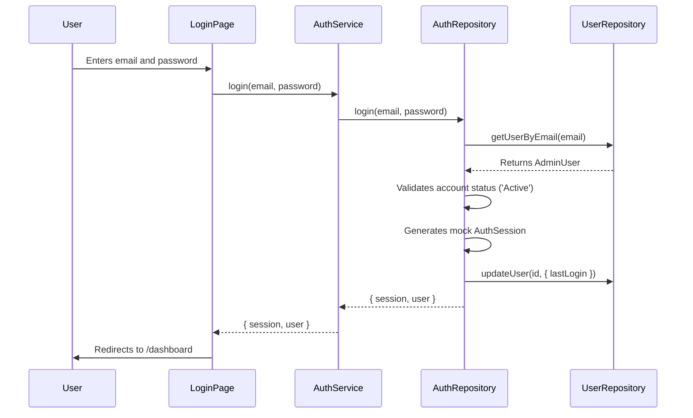
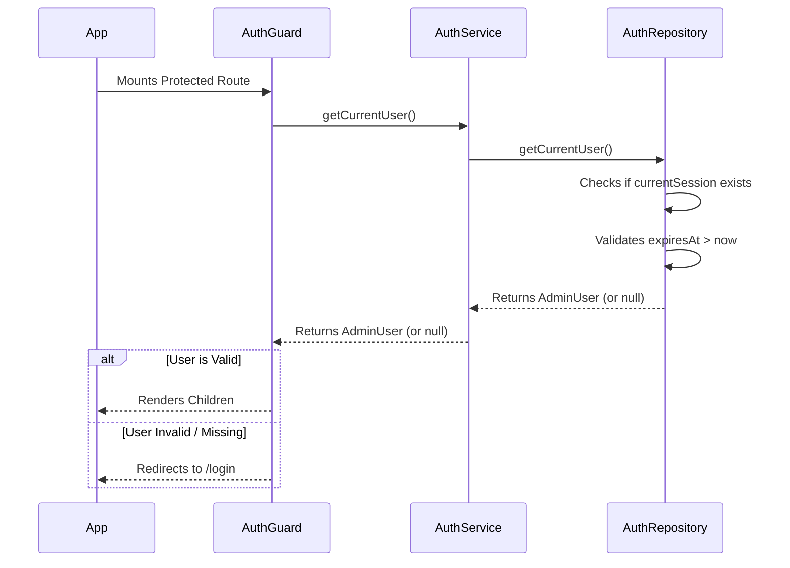
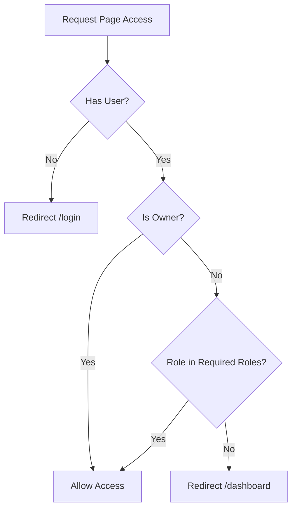

# Sprint 3.6 Walkthrough: Authentication & User Management

This sprint establishes the complete authentication architecture for the Admin application. The implementation is currently mock-only, but the architecture strictly mirrors the final production system that will use Auth.js, Prisma, and PostgreSQL in Sprint 4. The Customer application remains completely frozen and untouched.

## 1. Updated Repository Tree

```text
apps/admin/
├── app/
│   ├── (auth)/
│   │   ├── login/page.tsx
│   │   └── forgot-password/page.tsx
│   └── (protected)/
│       ├── layout.tsx
│       ├── dashboard/page.tsx
│       ├── homepage/page.tsx
│       ├── categories/page.tsx
│       ├── products/page.tsx
│       ├── media/page.tsx
│       ├── business/page.tsx
│       ├── profile/page.tsx
│       └── users/
│           ├── page.tsx
│           ├── new/page.tsx
│           └── [id]/edit/page.tsx
├── components/
│   ├── layout/
│   │   └── sidebar.tsx
│   └── providers/
│       └── auth-provider.tsx
└── features/
    ├── auth/
    │   ├── repositories/auth-repository.ts
    │   └── services/auth-service.ts
    ├── users/
    │   └── repositories/user-repository.ts
    └── audit/
        └── repositories/audit-repository.ts
```

## 2. Authentication Architecture Diagram

```mermaid
graph TD
    UI[UI Components / Pages] --> |useAuth()| AP[AuthProvider / Context]
    AP --> AS[AuthService]
    AS --> AR[AuthRepository]
    AR --> MS[Mock Session State]
    AS --> UR[UserRepository]
    UR --> MU[Mock Users Data]

    subgraph "Sprint 4 Migration Path"
        MS -.-> |Replaced By| AJ[Auth.js]
        MU -.-> |Replaced By| PR[Prisma / PostgreSQL]
    end
```

## 3. Login Flow



## 4. Session Flow



## 5. Permission Flow (RBAC)

The `AuthService` handles authorization checks via `hasPermission(user, requiredRoles)`.



**Role Definitions & Access Rules:**

- **Owner**: Full access to all modules, cannot be deleted, cannot have their role changed, cannot be disabled.
- **Manager**: Access to Products, Categories, Media, Homepage, Business Info, Appearance. Cannot access User Management.
- **Staff**: Access to Products, Categories, Media. Cannot access Homepage, Business Info, Appearance, or User Management.

## 6. Verification Checklist

- [x] Zero TypeScript errors
- [x] Zero ESLint errors
- [x] Login works (mock implementation)
- [x] Protected routes work (bounce to login if unauthenticated)
- [x] Role preparation complete (Owner, Manager, Staff)
- [x] Sidebar reflects current user (displays avatar, name, and restricted links based on role)
- [x] User management works (CRUD, soft deletes)
- [x] Repository abstraction maintained (UI never talks to mock state directly)

## 7. Sprint Walkthrough

**Objective Achieved:** We successfully created a production-quality authentication and user management architecture using a strict Repository Pattern.

- **Authentication Foundation**: Built `(auth)` and `(protected)` route groups to handle access cleanly. Developed a fully branded login page and a mock forgot-password flow. Integrated an `AuthProvider` context and a reusable `AuthGuard` that handles client-side protection and Role-Based Access Control (RBAC).
- **User Management System**: Created the `/users` portal with complete CRUD operations powered by the mock `UserRepository`. Implemented critical protections, including soft deletion and specific rules to safeguard the "Owner" account from being modified, disabled, or deleted.
- **Audit Logging Preparation**: Established the `AuditRepository` with the `AuditLogEntry` interface, ready to log `userId, action, timestamp, entity, oldValue, newValue` when PostgreSQL is integrated.

All UI components exclusively communicate through the `AuthService`, ensuring that when we introduce Auth.js, Prisma, and PostgreSQL in Sprint 4, the frontend code will require zero modifications.

This completes the deliverables for Sprint 3.6!
